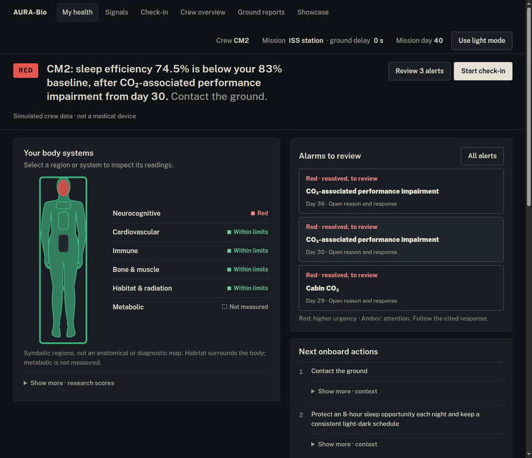
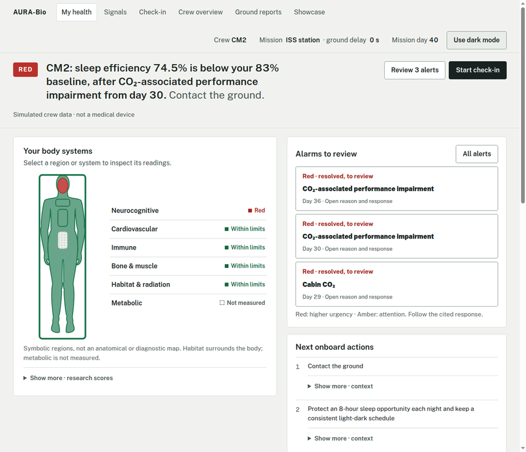
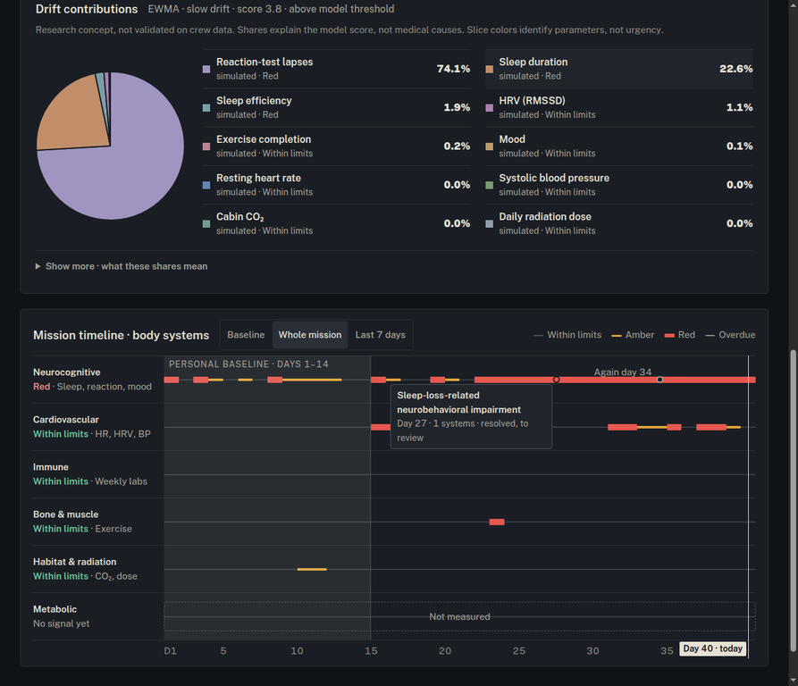

# Complete silhouette, drift pie and showcase verification

The existing FastAPI-served AURA-Bio console now uses a different complete-body web vector, a backend-driven contribution pie with ten named parameter shares, and four safe simulated showcase walkthroughs. No replacement app, model retraining, new health threshold or game-runtime rebuild was introduced.

## Complete silhouette

The source is Openclipart’s **Male body silhouette**, item 82639, authored by **mlampret**, released under Openclipart’s CC0/public-domain policy. The original is vendored unchanged with SHA-256 `0deff48bf3409b7f3c3c0d42730242f69908d9d80c68d270d1130f7642cda325`. Source and license: https://openclipart.org/detail/82639/male-body-silhouette, https://openclipart.org/download/82639/body-shape.svg and https://openclipart.org/share. Attribution and history are in `web/static/images/SOURCES.md`.

The console retains the complete original path, all its attributes, source group transform and native `viewBox="0 0 278.8 984.46"`. There are no clipPaths, masks, anatomical cut-outs or removed neck/shoulder/hand/foot segments. The entire source figure is the bone/muscle selector under separate head and torso overlays; the surrounding frame selects habitat/radiation. These are symbolic system controls, not diagnostic anatomy. CSS changes presentation color, not path geometry.

Actual browser inspection confirmed a real `SVGPathElement` with non-zero bounds, the original transform, no clipping/masking nodes, and all six controls opening the corresponding named detail. Enter on the full-body control opened bone/muscle readings. Initial namespace serialization that did not render the complete group was fixed and guarded by a regression assertion.

## Backend contribution pie

The pie uses only `status.anomaly.contributions` from the backend’s winning detector, not invented weights or a frontend health calculation. It normalizes the backend’s rounded shares for drawing, keeps every zero share in the named list, and states which detector/score is being displayed. Slice colors identify parameters, not urgency. Signal provenance and current backend band remain readable beside each percentage. Weekly immune labs and unmeasured metabolic signals are explicitly outside this model’s inputs.

For the original CM2 output, the backend shares summed to `0.999`; the drawn values summed to exactly `100%` and matched each returned parameter divided by that total. All ten parameters remained listed, including three zeros. Theme switching preserved the numeric dataset and recolored its boundaries. Missing, invalid, unavailable and all-zero output does not become an equal-share pie; baseline-not-ready was also observed during the actual nominal replay.

The actual completed sleep-debt showcase produced EWMA score `3.811`, above the model threshold. Displayed contributions included reaction-test lapses `74.1%`, sleep duration `22.6%`, sleep efficiency `1.9%`, HRV `1.1%`, exercise completion `0.2%`, mood `0.1%`, and four zero shares. These percentages explain detector terms, not medical causes or probabilities. The model remains labelled a research concept, not validated on crew data.

Enter on the chart’s equivalent Sleep duration button opened that demo crew’s existing trend with its `6.7 h` baseline, `3.8 h` current value and proposed `7 h`/`5 h` limits. The same existing trend dialog is used by slice clicks and named parameter buttons.

## Four actual showcase replays

The **Showcase** view presents nominal flight, cabin CO₂ creep, accumulating sleep debt and sensor dropout. Each uses an existing seed-12 simulation with its approved effects, a descriptive story, what-to-watch guidance, replay pace and dedicated demo crew. Each non-normal event begins at Mission day 22; daily baseline and weekly-lab timing remain distinct. The existing manual Mission replay remains available with its original replacement warning.

All four actual replays completed **40 simulated days** in the running core. CO₂ creep generated `co2_performance` episodes; sleep debt generated `sleep_loss_impairment` episodes; sensor loss ended with both resting heart rate and RMSSD marked **stale**. Normal replay was started through the actual console button, switched to `demo_normal`, showed baseline-not-ready followed by available model output, and completed. A visible simulated-showcase banner linked the guide and offered Return to CM2; keyboard activation returned to the original crew.

Nominal means no injected scenario effect, not that all signals must be green. Seeded normal variation can still cross a configured limit. Alert episodes can resolve later in the replay; they remain reviewable, and acknowledgment remains distinct from resolution. No scenario fabricates a guaranteed active alarm at day 40.

The showcase reset atomically claims a demo ID in a persistent additive SQLite ownership table. A reserved-looking ID that already has non-showcase data receives HTTP `409` and nothing is reset. Known demo ownership survives a runner/core restart. Games are retained, and a running replay cannot be started again. Delayed REST, history, trend and WebSocket responses are crew/revision-scoped to prevent readings appearing under the wrong crew after a switch.

Before/after comparison confirmed the original **CM2 status, timeline and seven saved games unchanged**. Its original **424 readings** were retained; total core readings became **2,082** after adding the four demo crews. Final health showed MQTT connected and **zero rejects**. No global mission preset was changed. The trained model version remained `8d30c5cab8db`.

See [the scenario guide](showcase-scenarios.md) for launch/API details and [structured actual runtime evidence](verification/showcase-runtime-evidence.json) for the recorded output.

## Checks and boundaries

Final complete regression: **160 passed, 1 existing local-artifact skip, 1 existing Starlette/httpx deprecation warning**, in `109.93 s`. Focused UI, collision, restart/game-preservation and delayed-response checks passed. Node syntax and `git diff --check` passed. Actual rendered inspection used a **1280 × 1100 CSS-pixel desktop viewport**, with no horizontal page overflow on the inspected console/showcase views; saved screenshots are scaled images, not mobile captures.

All required SVG, chart-library and console assets remain local. The new code was loaded into the existing core container using scoped file copies and a restart on the unchanged data volume; the next regular core build includes the committed files. Managed diagnostics were unavailable because this repository is not an initialized Manus webdev project, so existing syntax/tests and the actual browser were used instead. No new managed app or production publication was created.

Not checked: physical hardware calibration, real crew or clinical/flight validation, phone layouts or full assistive-technology testing. Games and the console still need a reachable local AURA-Bio server. Showcase progress is refreshed explicitly; persisted demo readings remain available after a core restart, while in-memory progress returns to ready.
